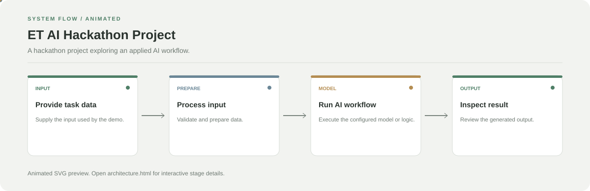

# ET AI Hackathon Project

**A hackathon project exploring an applied AI workflow.**

[](https://github.com/chyk2468/ET-AI-HACKATHON)

## 1. Project Title & Tagline

A hackathon project exploring an applied AI workflow.

## 2. Problem Statement

The project explores how an AI-based workflow can support a defined task. The exact problem, data, and evaluation should be described from the current source and demo rather than assumed.

## 3. Project Preview

Add a real screenshot, GIF, or public demo showing the current implementation.

[Open interactive architecture](architecture.html)

## 4. Overview

This repository is organised around a small sequence of input, processing, and output stages. Use the code and configuration files to verify which stages are currently implemented.

## 5. Key Features

- Explore the implemented task and interface.
- Run the available model or processing workflow.
- Inspect the output and configuration.
- Use the repository notebook or application as the starting point.

## 6. Architecture / Workflow



Open the [interactive architecture explorer](architecture.html) to select a stage and inspect its role.

## 7. Tech Stack

Use the dependencies and environment files in the repository as the source of truth.

## 8. Installation & Setup

```bash
git clone https://github.com/chyk2468/ET-AI-HACKATHON.git
cd ET-AI-HACKATHON
```

Install the dependencies required by the included notebook or application.

## 9. Usage

Open the primary notebook or application, configure its expected inputs, and run the documented steps in order. Verify the actual output before describing performance.

## 10. Project Structure

Start with the main notebook or app, then follow the data preparation, model, and interface files referenced by it.

## 11. Results & Demo

Add the hackathon demo, screenshots, evaluation results, and a brief explanation of the test data used.

## 12. Future Enhancements

- Document the task and success criteria clearly.
- Add a reproducible evaluation split.
- Improve input validation and failure handling.
- Package the demo for easier local setup.

## 13. License

Check the repository and dataset licences before redistributing code or data.
